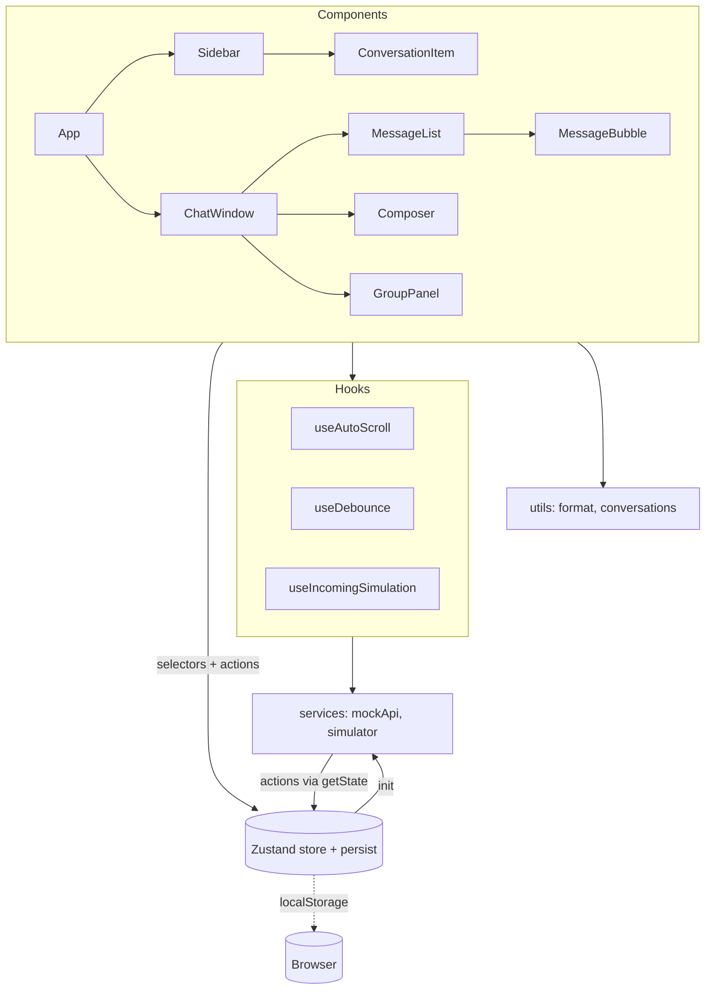
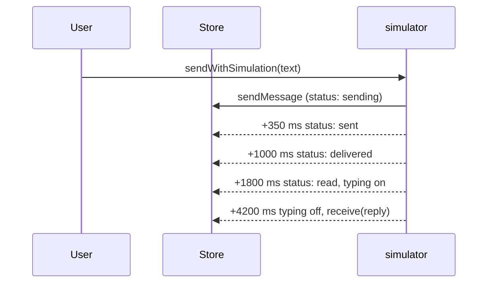

# Murmur

Murmur is a responsive, themeable chat client built with React, TypeScript, Zustand and Tailwind CSS. It has no backend. Conversations, typing indicators, delivery receipts, presence changes and incoming messages are all simulated in the browser, behind a service layer that is designed to be swapped for a real API and WebSocket client.

## Table of contents

1. [Features](#features)
2. [Tech stack](#tech-stack)
3. [Getting started](#getting-started)
4. [Available scripts](#available-scripts)
5. [Architecture](#architecture)
6. [Project structure](#project-structure)
7. [Data model](#data-model)
8. [State management](#state-management)
9. [Simulation layer](#simulation-layer)
10. [Theming and styling](#theming-and-styling)
11. [Testing](#testing)
12. [Configuration and debugging](#configuration-and-debugging)
13. [Moving to a real backend](#moving-to-a-real-backend)
14. [Known limitations](#known-limitations)
15. [Troubleshooting](#troubleshooting)

## Features

**Conversation list (sidebar)**

- Avatars with presence indicators, last message preview, timestamps and unread badges
- Debounced search (200 ms) across conversation names and message text
- All, Unread and Groups filters, with a live unread total on the Unread tab
- Skeleton loading state, empty state, and an error state with a retry button

**Chat window**

- Delivery receipts: sending, sent, delivered and read
- Typing indicator in both the header subtitle and the message list
- Date dividers (Today, Yesterday, then weekday and date)
- Smart auto scroll: follows new messages only when the reader is near the bottom, always follows the user's own messages, and shows a scroll to bottom control otherwise
- Reply to a message, edit your own messages, delete your own messages (shown as a tombstone), copy text, and react with one of six emoji
- In conversation message search with match highlighting
- Group info panel with a member list and mock add and remove member actions
- Keyboard support: Enter to send, Shift+Enter for a new line, Esc to cancel a reply or edit

**Platform**

- Light and dark themes, defaulting to the operating system preference
- Responsive layout: single pane navigation on mobile, two panes from the `md` breakpoint
- Optimistic sending
- State persisted to `localStorage`
- Accessible roles and labels (`role="log"`, `aria-live` regions, labelled icon buttons, visible focus rings)

## Tech stack

| Concern | Choice |
| --- | --- |
| UI library | React 18 |
| Language | TypeScript 5 (strict mode) |
| Build tool and dev server | Vite 5 |
| State | Zustand 4 with the `persist` middleware |
| Forms | React Hook Form 7 (message composer) |
| Styling | Tailwind CSS 3 with CSS variable design tokens |
| Icons | lucide-react |
| Tests | Vitest 2, Testing Library, jsdom |

## Getting started

### Prerequisites

- Node.js 18.18 or newer (Node 20 LTS recommended)
- npm 9 or newer

### Install and run

```bash
# 1. Install dependencies
npm install

# 2. Start the dev server (opens http://localhost:5173)
npm start
```

If you prefer not to open a browser tab automatically, use `npm run dev` instead.

### Production build

```bash
npm run build      # type checks with tsc, then builds to dist/
npm run preview    # serves dist/ locally at http://localhost:4173
```

The output in `dist/` is a static site and can be hosted on any static file host.

### First run

On first load the app shows a skeleton list for about 700 ms while the mock API resolves, then seeds 7 conversations (4 direct, 3 groups) and 9 users. After that, state lives in `localStorage` under the key `murmur-chat-v2`.

## Available scripts

| Command | Description |
| --- | --- |
| `npm start` | Runs Vite and opens the browser |
| `npm run dev` | Runs Vite without opening the browser |
| `npm run build` | Runs `tsc` for type checking, then `vite build` |
| `npm run preview` | Serves the production build locally |
| `npm test` | Runs the Vitest suite once |
| `npm run test:watch` | Runs Vitest in watch mode |

## Architecture

Murmur is organised as a single feature module (`src/features/chat`) with four layers. Dependencies point in one direction: components depend on the store, hooks and utilities, and services depend on the store through its public actions. The store never imports from components or the simulator.



### Layer responsibilities

| Layer | Location | Responsibility |
| --- | --- | --- |
| Components | `src/features/chat/components` | Rendering and user interaction. Read state through selectors and call store actions. |
| Hooks | `src/features/chat/hooks` | Reusable behaviour: debouncing, scroll management, starting and stopping the simulation. |
| Store | `src/features/chat/store` | The single source of truth for conversations, messages, users, typing state, theme and load status. |
| Services | `src/features/chat/services` | Everything that pretends to be a server: seed data, fake latency, replies, receipts and presence. |
| Utils | `src/features/chat/utils` | Pure functions for date grouping, label formatting, conversation filtering and class names. |

### Component tree and layout

`App` renders a two pane shell. The sidebar and the chat window are both always mounted, and CSS decides which is visible:

- Below `md`, only one pane shows at a time. The sidebar is shown when no conversation is active, and the chat window is shown otherwise. The back arrow in the chat header clears `activeId`.
- From `md` up, both panes show side by side. The sidebar is 320 px wide at `md` and 380 px at `lg`.
- From `lg` up, the shell sits inside a rounded, shadowed card on a decorative backdrop. The group info panel docks to the right at `lg` and overlays the chat on smaller screens.

`ChatWindow` renders `ChatView` with `key={conv.id}`, so switching conversations remounts the view. That resets the search box, the open panel and the composer draft without any manual cleanup.

## Project structure

```
murmur-chat/
├── index.html                  Entry HTML, loads Instrument Sans and Instrument Serif
├── package.json
├── tsconfig.json               Strict TypeScript, bundler module resolution
├── vite.config.ts              Vite and Vitest configuration (jsdom, setup file)
├── tailwind.config.js          Maps CSS variables to Tailwind colour tokens
├── postcss.config.js
└── src/
    ├── main.tsx                React root, StrictMode
    ├── App.tsx                 Layout shell, store init, theme class, simulation start
    ├── index.css               Design tokens (light and dark), keyframes, helper classes
    ├── test/
    │   └── setup.ts            jest-dom matchers, RTL cleanup, scrollTo stub
    └── features/chat/
        ├── types.ts            Domain types and the ME constant
        ├── components/
        │   ├── Sidebar.tsx            Header, theme toggle, search, filters, list states
        │   ├── ConversationItem.tsx   One row in the conversation list (memoised)
        │   ├── ChatWindow.tsx         Empty state, header, search bar, panel wiring
        │   ├── MessageList.tsx        Date grouping, search filtering, typing indicator
        │   ├── MessageBubble.tsx      One message, actions, reactions (memoised)
        │   ├── Composer.tsx           Textarea, reply and edit banner, keyboard handling
        │   ├── GroupPanel.tsx         Members, add and remove
        │   ├── Avatar.tsx             Image with initials fallback and presence dot
        │   └── Composer.test.tsx
        ├── hooks/
        │   ├── useAutoScroll.ts
        │   ├── useDebounce.ts
        │   └── useIncomingSimulation.ts
        ├── services/
        │   ├── mockApi.ts             Seed data, fake fetch, reply rules
        │   └── simulator.ts           Receipts, typing, replies, incoming messages, presence
        ├── store/
        │   ├── chatStore.ts           Zustand store with persistence
        │   └── chatStore.test.ts
        └── utils/
            ├── conversations.ts       conversationTitle, filterConversations, initials, cn
            ├── format.ts              formatTime, dayLabel, sidebarStamp, groupByDate
            └── utils.test.ts
```

## Data model

Defined in `src/features/chat/types.ts`.

```ts
type DeliveryStatus = 'sending' | 'sent' | 'delivered' | 'read';

interface User {
  id: string;
  name: string;
  avatar: string;
  online: boolean;
}

interface Message {
  id: string;
  conversationId: string;
  senderId: string;
  text: string;
  createdAt: number;                       // epoch milliseconds
  status: DeliveryStatus;
  replyToId?: string;
  edited?: boolean;
  deleted?: boolean;                       // tombstone, text is kept but not shown
  reactions: Record<string, string[]>;     // emoji -> ids of users who reacted
}

interface Conversation {
  id: string;
  type: 'direct' | 'group';
  name: string;
  memberIds: string[];
  unread: number;
  lastMessageAt: number;
}
```

The current user always has the id `me` (exported as `ME`). Messages are stored as a map keyed by conversation id, so appending to or updating one conversation never touches the others. Direct conversation titles are derived from the other member at render time through `conversationTitle`, so a rename of a user is reflected everywhere.

## State management

All shared state lives in one Zustand store, `useChatStore`, in `src/features/chat/store/chatStore.ts`.

| Slice | Fields | Persisted |
| --- | --- | --- |
| Data | `users`, `conversations`, `messages` | Yes |
| Preferences | `theme` | Yes |
| Navigation | `activeId` | No |
| Composer targets | `replyToId`, `editingId` | No |
| Ephemeral | `typing`, `status`, `error` | No |

Persistence uses the `persist` middleware with `partialize`, so only the first two rows are written to `localStorage`.

### Why one store

A single `set` call can update messages, `lastMessageAt` and `unread` together. For example, `receive` appends a message, bumps the conversation, and increments `unread` unless the conversation is open and the tab is visible, all atomically. Selectors keep re-renders narrow, and `MessageBubble` and `ConversationItem` are memoised on top of that.

### What stays local

State that nothing else needs stays in the component that owns it: the sidebar search text and active filter, the in conversation search, the open panels, and the composer draft (React Hook Form).

### Rehydration

On `init`, if conversations were restored from `localStorage`, the store skips the mock fetch. Any message still in the `sending` state is promoted to `sent`, because its timers did not survive the reload.

## Simulation layer

All fake backend behaviour is in two files. Nothing outside `services/` knows the data is fake.

### `mockApi.ts`

- `buildSeed()` builds the users, conversations and message history, with timestamps relative to now so the date dividers always look realistic.
- `fetchChatData()` resolves after 700 ms. If the URL contains `?fail`, it rejects with a service error so the error state can be previewed.
- `generateReply(text)` matches the outgoing text against a small list of rules (greetings, thanks, meetings, food, questions and so on) and picks a fitting reply, falling back to a neutral acknowledgement.

### `simulator.ts`

`sendWithSimulation` is called by the chat window instead of `sendMessage` directly. It sends optimistically, then walks the message through its lifecycle on timers:



`startIncomingSimulation` runs for the lifetime of the app, started by the `useIncomingSimulation` hook:

- Every 22 seconds, a random member of a conversation other than the open one starts typing, then sends a canned message about 2.2 seconds later.
- Every 15 seconds, a random user flips between online and offline.

Every timer is tracked in a set and cleared by `clearSimulation`, which the hook's cleanup calls on unmount.

## Theming and styling

- Colours are defined as space separated RGB triplets in CSS variables in `src/index.css` (`--bg`, `--fg`, `--muted`, `--line`, `--soft`, `--surface`, `--accent`, `--onaccent`).
- `tailwind.config.js` maps each variable to a Tailwind colour using `rgb(var(--x) / <alpha-value>)`, so utilities such as `bg-accent/50` and `border-line` work in both themes.
- The `.dark` class on `<html>` swaps the variable values. `App.tsx` toggles that class from the store's `theme` value, and the initial theme follows `prefers-color-scheme`.
- Typography uses Instrument Sans for UI text and Instrument Serif (italic) for display headings, both loaded from Google Fonts with system fallbacks.
- Animations (message entry, typing dots, reaction pop, theme icon spin, floating shapes on the empty state) are plain CSS keyframes in `src/index.css`.

## Testing

```bash
npm test            # run once
npm run test:watch  # watch mode
```

| File | Covers |
| --- | --- |
| `src/features/chat/store/chatStore.test.ts` | Optimistic send with reply, edit and delete, per user reaction toggling, unread counting for background chats, adding and removing members (never removing yourself), typing state |
| `src/features/chat/utils/utils.test.ts` | Date divider grouping, Today and Yesterday labels, unread and group filters, search by name and by message text, contextual reply selection |
| `src/features/chat/components/Composer.test.tsx` | Enter sends and clears, Shift+Enter does not send, edit mode prefill and Esc to cancel |

Tests run in jsdom. `src/test/setup.ts` registers the jest-dom matchers, cleans up after each test, and stubs `Element.prototype.scrollTo`, which jsdom does not implement.

Before shipping a change, run both:

```bash
npm test && npm run build
```

## Configuration and debugging

| Goal | How |
| --- | --- |
| Preview the error state | Open `http://localhost:5173/?fail`, with `localStorage` cleared |
| Reset to the seed data | Clear the `murmur-chat-v2` key in `localStorage` (DevTools, Application tab) and reload |
| Force a theme | Use the toggle in the sidebar header. The choice is persisted. |
| Change simulation speed | Edit the `later(...)` delays in `sendWithSimulation` and the two intervals in `startIncomingSimulation` in `src/features/chat/services/simulator.ts` |
| Change mock latency | Edit the `wait(700)` call in `fetchChatData` in `src/features/chat/services/mockApi.ts` |
| Change seed content | Edit `buildSeed` in `src/features/chat/services/mockApi.ts`, then reset `localStorage` |

The error preview only applies on a fresh load, because once data is persisted the store skips the fetch.

## Moving to a real backend

The seams are already in place.

1. **Loading data.** Replace the body of `fetchChatData` with a real request that returns the same `ChatData` shape. The store's `init` action and the loading and error UI need no changes.
2. **Sending.** Replace `sendWithSimulation` with a function that calls `sendMessage` (the optimistic insert), posts to your API, and then calls `setStatus` with the result. Keep the returned message id so the receipt can be reconciled with the server copy.
3. **Receiving.** Open a WebSocket or SSE connection in place of `startIncomingSimulation` and translate events into existing store actions: `receive`, `setTyping`, `setPresence` and `setStatus`. The UI already reacts to all of these.
4. **Edits, deletes, reactions, membership.** The store actions (`editMessage`, `deleteMessage`, `toggleReaction`, `addMember`, `removeMember`) currently apply locally. Call your API alongside each one, and roll back on failure.
5. **Persistence.** With a server as the source of truth, narrow the `partialize` list in `chatStore.ts` to just `theme`, or switch to an IndexedDB backed storage adapter for an offline cache.
6. **Identity.** Replace the `ME` constant with the authenticated user's id.

## Known limitations

- The message list is not virtualised. It is fine for a few hundred messages per conversation. For very large histories, add `@tanstack/react-virtual` and feed it the same `groupByDate` item list.
- Persistence stores the whole message map in `localStorage`, which has a size limit of roughly 5 MB. IndexedDB would scale better.
- There is no infinite scroll or pagination, offline send queue, attachments, or read receipts per member in groups.
- Avatars load from `i.pravatar.cc` and fall back to initials when offline. Fonts load from Google Fonts and fall back to system fonts.
- Deleted messages remain in the store as tombstones so that replies to them still make sense. Only the sender can delete or edit.
- The simulated replies are rule based and are not a language model.

## Troubleshooting

**The page shows a skeleton forever.** The store is in the `loading` state. Check the browser console for errors, then clear `localStorage` and reload.

**The error state appears and Try again does nothing.** The URL still contains `?fail`. Remove it and reload.

**Old data or removed conversations keep coming back.** State is restored from `localStorage`. Clear the `murmur-chat-v2` key.

**Port 5173 is already in use.** Vite will pick the next free port and print it in the terminal. To pin one, run `npx vite --port 3000`.

**Tests fail with `scrollTo is not a function`.** Make sure `src/test/setup.ts` is listed under `setupFiles` in `vite.config.ts`. It stubs `Element.prototype.scrollTo` for jsdom.

**`npm run build` fails on types but the dev server works.** Vite does not type check. Run `npx tsc --noEmit` to see the errors that `npm run build` reports.